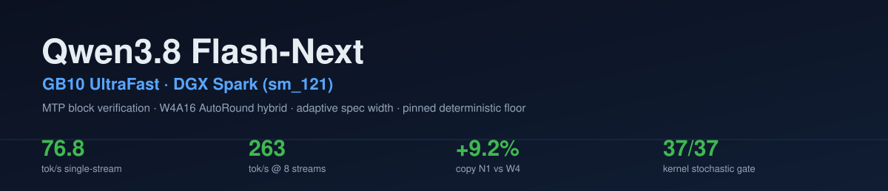
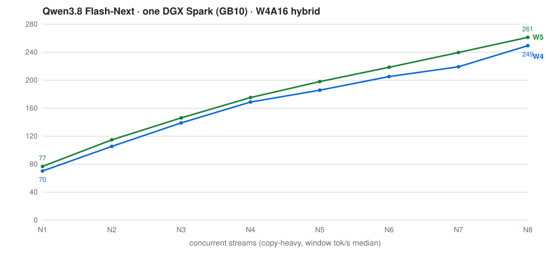

<!-- SPDX-License-Identifier: Apache-2.0 -->
<p align="center"></p>

# Qwen3.8 Flash-Next · GB10 UltraFast

A vLLM serving recipe for Qwen3.8-Flash-Next on a single NVIDIA DGX Spark or other GB10 system.

The promoted configuration, **v19a-w5** (MTP=4 window-5 on the deterministic floor), decodes a copy-heavy workload at up to **76.8 tok/s** on one stream and **265.9 tok/s** aggregate across eight concurrent streams, **+9.2% (+6.4 tok/s) over the same floor at MTP=3**, measured head-to-head on the same pinned image with two boots per arm (medians and per-boot spreads in [docs/benchmarks](docs/benchmarks)). The speed still comes from MTP speculative decoding with block rejection, not lower-bit target weights.

**What this fork adds on top of the upstream recipes:**

- **W5 width promoted**: MTP=4 on the copy/code axis (+9.2% N1, +4.8% N8 over the MTP=3 reference, same floor).
- **Chinese throughput +31.3%**: the draft vocabulary rebalanced from 182 to 25,862 Han ids (0.28% to 39.5% of the 65,536-id draft vocab), built from a 48.7M-token mixed corpus; prose-zhen 34.8 to 45.7 tok/s at equal verified quality, ~+20% sustained on the promoted window.
- **A verified-deterministic floor**: the MoE `moe_align_block_size` arrival-order shim, the drafter-Marlin atomicAdd epilogue fix, the pinned triton config and the compile-cache mount, with runtime behavioral fingerprints (AWFP).
- **Kernel-level stochastic-correctness gate, 37/37**: known conditional distributions through the real GPU block verifier against a bit-exact fp64 oracle, chained K=2/3/4 statistics, and five sensitivity controls that must be rejected.
- **Owner-shaped benchmarks**: multi-turn tool loops and real file-edit suites with per-run verification, alongside the copy/prose/code suite.
- **Every number ships with its raw per-round data and the script that measured it** ([docs/benchmarks](docs/benchmarks/)).
- **A recorded failure, not a hidden one**: `copy-agentic-1` fails at rep 2 on three independent W5 boots (attribution unresolved, reproduction queued), see [docs/benchmarks](docs/benchmarks).

**Headline: 76.8 tok/s single-stream, 261.2 tok/s aggregate at 8 concurrent streams on one DGX Spark, +4.6% over the stock baseline at every concurrency point. Full tables in [Results](#results) below.**

    

## Requirements

- One NVIDIA GB10 with about 121 GB of unified memory, ARM64 Linux, and **rootless podman** (4.x works; the Troubleshooting section covers its quirks) with the NVIDIA container toolkit installed for CDI generation.
- A driver compatible with the pinned CUDA 13.0 image. Check `nvidia-smi` and a GPU container before building.
- Local storage, preferably NVMe, for the checkpoint, FP8 PLE table, downloads and container storage (about 130 GB free for the upstream checkpoint and table), plus about 4.8 GiB for the T80 drafter shard data.
- Python 3, the Hugging Face `hf` CLI, `jq`, GNU `md5sum` and `sha256sum`.

## Quick start

### With a coding agent

Run a coding agent that can use a terminal on your everyday computer, and paste this prompt. The agent connects to your GB10 over SSH and does the setup there. Set up key-based SSH login to the GB10 first.

```text
Set up the Qwen3.8 Flash-Next GB10 UltraFast recipe on my GB10 over SSH.
Read AGENTS.md in this repository and follow it exactly.
Ask me how to reach the GB10, run the read-only checks, show me what you found, and get my approval before you install, download, build or launch anything.
```

The agent first checks the GB10's hardware, memory, disk, container runtime and port 8000 without changing anything. It then asks for your approval before each of five steps: getting the repository and tools, downloading about 130 GB of public model files, building the image, building the drafter directory, and launching the server. Long steps run in the background on the GB10, so a dropped connection doesn't interrupt them. The agent never stops or removes anything that was already running. [AGENTS.md](AGENTS.md) has the full instructions.

### Manual

Download the pinned public checkpoint and PLE table, build the image and the T80 drafter directory, then launch v16b and send a test request. [BUILD.md](docs/BUILD.md) has the reference hashes, build report and what each step checks.

```bash
# Clone and install the Hugging Face CLI
git clone https://github.com/kyaky/qwen3.8-flash-next-gb10-ultrafast.git
cd qwen3.8-flash-next-gb10-ultrafast
python3 -m venv recipe/.venv
. recipe/.venv/bin/activate
pip install --upgrade huggingface_hub

# Download the pinned checkpoint and FP8 PLE table
mkdir -p "$HOME/models/Qwen3.8-Flash-Next-W4A16-AutoRound-hybrid" "$HOME/models/ple-table-fp8"
hf download Saren/Qwen3.8-Flash-Next-W4A16-AutoRound-hybrid \
  --revision 8b82f0b7abe3d1150a7827d298c75e86267636ae \
  --local-dir "$HOME/models/Qwen3.8-Flash-Next-W4A16-AutoRound-hybrid"
hf download Saren/Qwen3.8-Flash-Next-ple-table-fp8 \
  --revision 50511b0a41aa1d34b8beb7e5d4bb06a0b650dc14 \
  --local-dir "$HOME/models/ple-table-fp8"

# Build the base image, the verification-gate image (iter7g), then the
# T80 dense-MTP drafter directory
bash recipe/build/image/build.sh --run
bash recipe/build/image/build-iter7g.sh --run
bash recipe/build/model/build.sh --run

# Show the full container command, then start the promoted server (runs detached)
bash recipe/config/v19a-w5/launch.sh --print
bash recipe/config/v19a-w5/launch.sh --run

# Wait for the server to load, then send a test request
until curl -fsS http://localhost:8000/v1/models >/dev/null 2>&1; do sleep 10; done
curl -fsS http://localhost:8000/v1/chat/completions \
  -H 'Content-Type: application/json' \
  -d '{"model":"qwen","messages":[{"role":"user","content":"Reply with OK."}],"max_tokens":512}'
```

Follow startup with `podman logs -f qwen38-flash`. The server exposes an OpenAI-compatible API on port 8000 under the model name `qwen`. It accepts text, images (`image_url`) and video (`video_url`), since the recipe keeps the model's vision encoder. Audio input is not supported. The T80 builder converts nine drafter modules at group size 32; its reference conversion took 4.626 s after download and wrote 5,118,048,680 new bytes.

> **Running on your own GB10?** If the recipe helped, a ⭐ helps other Spark owners find it, and your numbers are welcome as a benchmark submission.

## Results

### This fork, v19a-w5 (promoted) vs the MTP=3 reference vs the stock baseline, all on this machine, this bench

Measured on one GB10 (sm_121) on the iter7g floor (shim + MARLIN epilogue fix + pinned triton config + compile-cache mount), **two boots per arm, three rounds per stream count**; figures quoted are boot-matched medians unless stated. Stock anchor: v16b exactly as the upstream recipe ships it (iter6d image, stock vocabulary, no floor fixes). Per-round JSON and boot fingerprints in [docs/benchmarks](docs/benchmarks).

| Streams | 1 | 2 | 3 | 4 | 5 | 6 | 7 | 8 |
|---|---:|---:|---:|---:|---:|---:|---:|---:|
| **v19a-w5 (MTP=4, promoted)** | **76.7** | 114.8 | 146.1 | 175.2 | 198.0 | 218.5 | 239.5 | **261.2** |
| v19a-w4 (MTP=3, this floor) | 70.2 | 105.4 | 138.9 | 168.8 | 185.7 | 205.2 | 219.1 | 249.3 |
| stock v16b (community baseline, as shipped) | 73.3 | 109.0 | 140.0 | 166.7 | 185.5 | 209.8 | 230.0 | 249.8 |
| **v19a-w5 vs stock** | **+4.6%** | **+5.3%** | **+4.4%** | **+5.1%** | **+6.7%** | **+4.1%** | **+4.1%** | **+4.6%** |
| v19a-w5 vs v19a-w4 | **+9.2%** | +8.9% | +5.2% | +3.8% | +6.6% | +6.5% | +9.3% | +4.8% |
| v19a-w5 peak (best round) | 76.8 | 117.7 | 147.0 | 179.9 | 199.8 | 224.1 | 242.9 | **265.9** |

Cross-boot spread: N1 <0.3%; N3 up to +5.8% (146.1 to 154.6); the N8 headline is quoted in all three accountings (+4.79% boot-matched, +8.43% boot2-matched, +6.58% median-of-medians).

The promoted configuration beats the stock baseline at every concurrency point (+4.1% to +6.7%); the W4 reference is a wash against stock on the copy workload, its gains are in Chinese prose (below), which is the adaptive-width case in one table.

Quality on the same boots: code-edit 61.8 vs 59.4 tok/s (25/25 verified both arms), MGSM 16/16 both arms, prose-zhen 41.7 vs 43.2 (the known W5 CJK deep-acceptance trade-off), ctx128k within the noise band. Chinese context: prose-zhen on this floor runs **+20% over the stock-vocabulary baseline** (34.8 tok/s), the full +31.3% lands on the W4-style window, with reasoning quality verified (MGSM zh 16/16).

### Owner-shaped workloads (first live run on the promoted configuration)

Multi-turn tool loops (10 scenarios × 5) and real file-edit tasks (5 tasks × 5, verified by executing the repo's tests), the agentic shape the recipe is tuned for: structured tool-argument emission dominates the generated tokens.

| Suite | Runs | Verified | Median decode | Conditions |
|---|---:|---:|---:|---|
| Multi-turn tool loops | 50 (10 scenarios x 5) | 29 | **60.2 tok/s** | multi-turn tool loop, temp 1.0, streaming tool_calls, 12-turn cap |
| Real file edits (test-verified) | 25 (5 tasks x 5) | **25/25** | **62.1 tok/s** | real file-edit tasks, semantic-test verification, 7-file fixture |

The 29/50 is a first-round baseline with validator calibration pending and two turn-cap scenario failures, an observation rather than an acceptance gate. The kernel-level gate's criteria: marginal/cascade z<=5, TV<=0.04, length deviation<=0.006 across K=2/3/4 chained cap-event configs. One functional flake is recorded: `copy-agentic-1` failed at rep 2 on all three measured W5 boots (W4: 0/30, Fisher p~0.49); attribution is unresolved and a stateful reproduction is queued. `copy-agentic-1` shows a recorded functional failure at rep 2 on three W5 boots (attribution unresolved).

### Baseline reference (the v16b line, upstream's promoted configuration; the cold-prefill and fixed-suite figures below are measured on the v16b line and are not yet re-measured on v19a-w5)

v16b on one GB10 with the promoted launch settings. Each throughput figure is the fastest of three rounds on a copy-heavy, low-effort workload with a shared 9,600-token cached prefix, counted as completion tokens per second over the window in which all streams are decoding. [Method and per-round data](docs/BENCHMARKS.md#measured-peak-rates).

| Streams | 1 | 2 | 3 | 4 | 5 | 6 | 7 | 8 |
|---|---:|---:|---:|---:|---:|---:|---:|---:|
| Peak aggregate decode, tok/s | **74.1** | 110.0 | 132.9 | 155.5 | 175.8 | 191.5 | 205.8 | **212.2** |

<p align="center"><picture><source media="(prefers-color-scheme: dark)" srcset="docs/assets/throughput-dark.svg"></picture></p>

Cold prefill, with nothing cached, is 2× to 3.4× faster than the original recipe on the same GB10. Each rate is prompt tokens divided by cold time to first token, three repeats per cell, so it slightly understates pure prefill speed. [Method and data](docs/BENCHMARKS.md#cold-prefill).

| Cold prompt | 16k | 64k | 128k |
|---|---:|---:|---:|
| v16b prefill, tok/s | **4,016** | **2,426** | **2,213** |
| Original recipe prefill, tok/s | 1,171 | 1,071 | 1,065 |
| Increase | **+243%** | **+127%** | **+108%** |

| Measure | v16b | Conditions |
|---|---:|---|
| Decode step time | **52.33 ms** | Agent-shaped coding workload with thinking and tools; upstream base: 68.276 ms |
| Emitted tokens per target step | **3.69** | Median, copy-heavy workload, one stream |
| Time to first token, warm | **0.57 s** | Cached coding prompt |
| Time to first token, cold | **27.0 s** | 64k-token prompt, three repeats |
| Fixed-suite evaluation | **458/492** and **459/492** | 93.09% and 93.29%; seeds 20260908 and 20260910 |
| Long generation | **21/24** and **22/24** | Two readings, 12,000-token cap |
| Teacher-forced top-1 agreement delta | **−0.06 pp** | Pre-registered control band: 0.15 pp |
| KV pool / configured context | **16 GB / 262,144 tokens** | Promoted launch settings |
| Input | **Text, image and video** | The vision encoder is kept; checked with image and video requests on v16b |
| Model residency / available memory | **~71 GiB / 16.5 GiB** | Base recipe residency / v16b capacity-run low-water |

On the agent-shaped workload, v16b spends 23% less time per decode step than the upstream base, or 1.30× as many steps per second. [Benchmark method](docs/BENCHMARKS.md) · [Evaluation](docs/EVALS.md).

## Configuration

The promoted launch, **v19a-w5**, pins `GPU_MEM=0.01`, `KV_BYTES=16g`, `SEQS=8`, `CTX=262144`, **MTP depth 4** (the W5 window), block rejection with probabilistic draft sampling, the mixed 39.5%-Han draft vocabulary, and prefix caching, on the deterministic floor: the MoE arrival-order shim, the drafter-Marlin epilogue fix, the pinned triton config and the compile-cache mount (all set in [`recipe/config/v19a-w5/env`](recipe/config/v19a-w5/env)). `launch.sh` sources that env file under a cleared environment, so edit the file rather than exporting variables. Changing any pinned value produces a new variant whose speed and quality must be measured separately; the MTP=3 reference (v19a-w4) and the upstream-stock configuration (v16b) ship alongside it. [Configuration reference](docs/CONFIGURATION.md).

## How it works

```text
AutoRound INT4 experts + FP8 side layers + INT8 output head
             │
             ├── FP8 PLE table, read by mmap from storage
             ├── MTP depth 4 (adaptive 3-4), 65,536-id mixed draft vocabulary
             │   (39.5% Han, +31.3% Chinese prose throughput)
             └── fast PLE gather + piecewise CUDA graphs + prefix cache
                         ↓
                vLLM verifier and sampler → response
```

**Target precision.** AutoRound W4A16 packs the routed-expert weights to four bits with 16-bit activations. FP8 side layers and an INT8 output head keep the nonexpert paths at eight bits, where 3-bit GGUF and NVFP4 recipes compress target weights further. The FP8 PLE table is memory-mapped from storage rather than held entirely in GPU memory, which leaves room for the 16 GB KV pool.

**Drafting.** The dense T80 MTP drafter proposes three to four tokens per step (the promoted v19a-w5 runs the W5 window; the verification width adapts per step on the armed configuration). A 65,536-id draft vocabulary, rebalanced to 39.5% Han tokens for the Chinese gains above, and FP8 drafter experts make each proposal cheaper. The target verifies every drafted token with block rejection, so the drafter changes speed, not the output distribution. Unlike n-gram copy speculation, which needs a matching earlier span, the MTP head drafts from the model itself and also covers original code, reasoning and tool output.

**Per-step overhead.** A low-latency SM12x GEMM, a sort-free verify-path top-k and piecewise CUDA graphs trim compute, selection and launch overhead around each target pass. The image runs vLLM's V2 model runner, where async scheduling is on by default with MTP, and adds an asynchronous short-convolution host-to-device transfer, guarded recurrent-state alignment and retained draft prefix-cache blocks.

[Architecture and build provenance](docs/ARCHITECTURE.md).

## Benchmarks and evaluation

- **Stream curve.** Three rounds at each of 1 to 8 streams on the copy-heavy workload, reported as peak and median, with tokens per step and time to first token. The five-stream point was measured in two sessions. [Runner](recipe/benchmarks/bench_copy_streams.py) · raw per-round records in [docs/benchmarks](docs/benchmarks/).
- **Agent-shaped decode.** Cached long system prefix, tool schemas, six coding tasks, three repeats each, 1,500 generated tokens, thinking on. [Step-time comparison](docs/BENCHMARKS.md#agent-shaped-decode).
- **Quality.** A fixed 492-item suite (code with execution checks, math, knowledge, instruction following, tool calls, long-context needles), a 24-item long-generation arm and a teacher-forced prefill comparison. [Evaluation](docs/EVALS.md).

## Repository layout

| Path | Contents |
|---|---|
| [`AGENTS.md`](AGENTS.md) | Step-by-step instructions for a coding agent to set up the recipe on a GB10 over SSH, with your approval at each step |
| [`recipe/config/v19a-w5/`](recipe/config/v19a-w5/) | **Promoted** launcher, `env` (the deterministic floor + MTP=4) and draft vocabulary ids |
| [`recipe/config/v19a-w4/`, `v16b/`](recipe/config/) | The MTP=3 reference and the upstream-stock configuration |
| [`recipe/build/image/`](recipe/build/image/) | Staged iter6→iter7g Dockerfiles, the patch chain, hash preflight, CPU tests and the verification-gate runner |
| [`recipe/build/model/`](recipe/build/model/) | T80 dense-MTP g32 checkpoint builder, tests and reference report |
| [`recipe/benchmarks/`](recipe/benchmarks/) | Stream-curve, agent-shaped and standalone decode benchmark scripts |
| [`docs/benchmarks/`](docs/benchmarks/) | Raw per-round JSON and boot fingerprints for every number in this README |
| [`docs/`](docs/) | [Build](docs/BUILD.md), [configuration](docs/CONFIGURATION.md), [architecture](docs/ARCHITECTURE.md), [benchmarks](docs/BENCHMARKS.md), [evaluation](docs/EVALS.md) and [changelog](docs/CHANGELOG.md) |

## Troubleshooting

Rootless podman notes (each hit live during the conversion):

- **podman <5 with nvidia-ctk >= 1.20**: the generated CDI spec carries an `additionalGids` field that podman 4.x's parser rejects ("unresolvable CDI devices"). Strip it: `sudo sh -c 'sed "/additionalGids/d" /etc/cdi/nvidia.yaml > /etc/cdi/nvidia-fixed.yaml && mv /etc/cdi/nvidia-fixed.yaml /etc/cdi/nvidia.yaml'`, or upgrade to podman 5.
- **`--shm-size` with `--ipc=host` is rejected** by podman; drop the flag and the host's `/dev/shm` (61 GB here) serves the container.
- **The image's `/root` is not writable rootless** (image files are owned by host uid 0): mount a user-owned directory over it (`-v "$HOME/gb10-podman-root:/root"`), or vLLM's registry subprocess fails writing its cache.
- **triton cannot find the mounted driver library**: triton reads `/sbin/ldconfig -p`, which is stale inside the image for runtime-mounted libs. Pass `TRITON_LIBCUDA_PATH=<dir-with-libcuda>` (wired in the launch scripts).
- **The driver-library set must include the PTX JIT compiler** (`libnvidia-ptxjitcompiler.so.1`) plus nvvm/allocator/cfg, or the engine init fails with "PTX JIT compiler library not found" the first time a kernel needs JIT compilation. The launch scripts mount the full set.

- **podman <5 with nvidia-ctk >= 1.20**: the generated CDI spec carries an `additionalGids` field that podman 4.x's parser rejects ("unresolvable CDI devices"). Strip it: `sudo sh -c 'sed "/additionalGids/d" /etc/cdi/nvidia.yaml > /etc/cdi/nvidia-fixed.yaml && mv /etc/cdi/nvidia-fixed.yaml /etc/cdi/nvidia.yaml'`, or upgrade to podman 5.
- **cached_tokens reports zeros below one block**: on this hybrid architecture the prefix-cache accounting is granular to the 1,600-token mamba-aligned block; prompts shorter than one block always report cached 0 even when serving reuses them.
- **First verify window keeps its own proposal width**: a request's first speculative window runs at its own first-proposal width (one-step lag), not the launch width; the gate harness asserts this (S1/S6) and it is expected behavior, not a defect.

<p align="center"><a href="https://buymeacoffee.com/kyaky" target="_blank"></a></p>

## Acknowledgements

This project's design took shape against Restech Technology Services, UNSW's self-hosted high-performance inference infrastructure, and this project owes that service a direct debt: the GB10 hardware and the compute access that made the work possible at all came from there. Qwen3.8-flash-next-gb10-ultrafast is an independent project and is not affiliated with UNSW; the acknowledgement is where the lineage ends.

## Credits and licenses

The Qwen model authors and the vLLM, Intel AutoRound and FlashInfer contributors. Model weights and downloaded datasets keep their own terms.

Everything in this repository, code, docs, data and images, is licensed under **Apache-2.0**. You can use, modify and redistribute it, including commercially. See [LICENSE](LICENSE).

GitHub's "Cite this repository" menu reads [CITATION.cff](CITATION.cff).


## Draft vocabulary note

The promoted configuration ships a **mixed 65,536-id draft vocabulary**, 25,862 Han entries (39.5%) built from a cleaned 48.7M-token corpus (Chinese Wikipedia, Chinese technical docs, code), which is what delivers the +31.3% Chinese prose throughput. The upstream English/code-weighted set ships alongside it (`draft-vocab-ids-K65536.txt` in the stock config) for pure-English sessions. Output quality is unaffected either way, because the target model verifies every drafted token with block rejection; the vocabulary changes which tokens get *drafted*, not what the target can *say*. See [Configuration](docs/CONFIGURATION.md#draft-vocabulary) for details.
